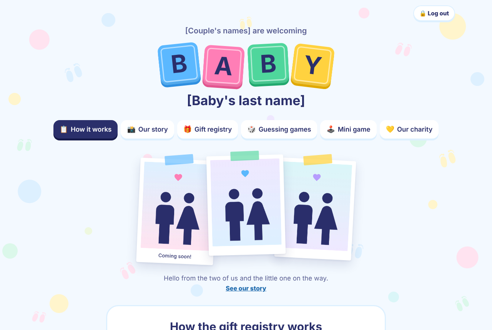
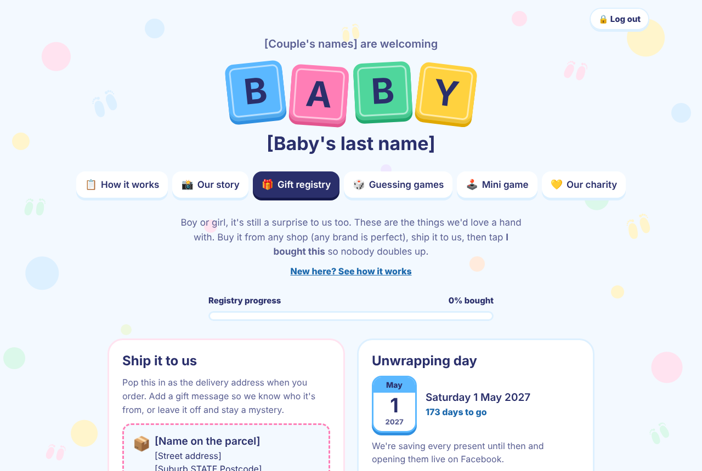
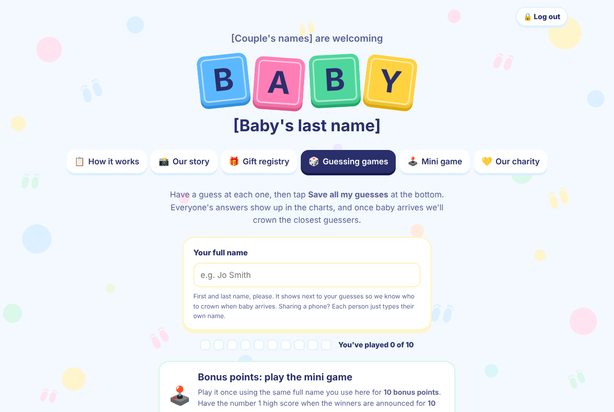
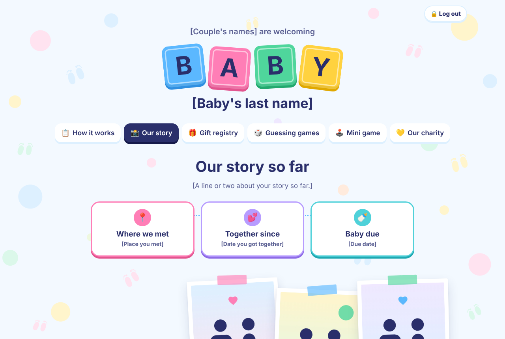

# Baby Registry Template

A self-hosted, private baby registry website for family and friends. It has a gift list where guests mark what they've bought so nobody doubles up, guessing games with prizes and a live leaderboard, a mini game with a high score board, a charity donation log, a photo story page and a printable keepsake for the baby book.

It runs as one small Node.js server with no dependencies and keeps everything in a single JSON file on your own machine. There's no database, no accounts, no tracking and no third-party services.

| How it works | Gift registry |
|---|---|
|  |  |
| **Guessing games** | **Our story** |
|  |  |

## Features

- **Private:** guests enter a 4 to 10 digit code from your invite. Wrong guesses get locked out.
- **Gift registry:** categories, search and filters. Guests tap "I bought this", pick how many and add their name (or a funny one, or stay anonymous). They can undo it from the same device, and there's a "Bought something else?" box for gifts that aren't on the list.
- **Shipping details:** a copyable delivery address and an unwrapping-day countdown.
- **Guessing games:** boy or girl, name, date, time, weight, length, hair and looks. Charts show everyone's guesses. Once you fill in the real answers, points, category winners and an overall leaderboard appear, with blue or pink fireworks when guesses are saved.
- **Mini game:** "Baby's big drive", a five-lane play-rug driving game with a top 30 scoreboard. Playing it adds bonus points in the guessing games.
- **Charity:** a donation log with a running total.
- **Our story:** milestones and photo chapters shown as polaroids.
- **Keepsake:** open `/#keepsake` for an A4 printable copy of everything.
- **Easy to look after:** your data is saved safely and backed up every hour, and settings changes go live without a restart.

## Quick start (Docker)

1. Copy this repo to your server, for example `/mnt/your-pool/baby-registry`.
2. Edit `config/registry.json` and replace everything in `[square brackets]`: your names, the address, the charity, baby name options, the story text and your own `accessCode`.
3. Swap the pictures in `config/photos/full` and `config/photos/thumb` for your own (keep the names, or update them under `"story"`).
4. Update the folder paths and time zone in `compose.yaml`, then run:

```
docker compose up -d
```

5. Open `http://your-server:3480` and enter your code.

Put it behind HTTPS (for example a Cloudflare tunnel or a reverse proxy) before sharing the link.

Without Docker, run it with Node.js 22 or newer:

```
CONFIG_FILE=./config/registry.json DATA_DIR=./data PORT=3480 node app/server.js
```

## Editing and backups

See [docs/EDITING.md](docs/EDITING.md) for changing the gift list, revealing the guessing game answers, removing an entry, photos and backups.

Everyone's purchases, guesses and scores live in `data/state.json`. It's never committed (see `.gitignore`), and hourly copies are kept in `data/backups`.

## Credits

- Gift icons: [IconPark](https://github.com/bytedance/IconPark) by ByteDance, Apache License 2.0.
- Placeholder silhouettes: [Material Design Icons](https://github.com/Templarian/MaterialDesign), Apache License 2.0.
- Fonts: Fredoka and Nunito from Google Fonts (SIL Open Font License).

## Licence

GPL-3.0. See [LICENSE](LICENSE).

Made by Plenty Technologies.
